<div align="center">


<picture>
  <source media="(prefers-color-scheme: dark)" srcset="https://readme-typing-svg.demolab.com?font=Fira+Code&amp;weight=600&amp;size=21&amp;duration=2600&amp;pause=900&amp;color=00FF88&amp;center=true&amp;vCenter=true&amp;width=650&amp;lines=%3E+Hello%2C+World!;%3E+I+have+no+idea+why+this+works.;%3E+Works+on+my+machine%E2%84%A2;%3E+99+bugs+in+the+code..." />
  <source media="(prefers-color-scheme: light)" srcset="https://readme-typing-svg.demolab.com?font=Fira+Code&amp;weight=600&amp;size=21&amp;duration=2600&amp;pause=900&amp;color=167544&amp;center=true&amp;vCenter=true&amp;width=650&amp;lines=%3E+Hello%2C+World!;%3E+I+have+no+idea+why+this+works.;%3E+Works+on+my+machine%E2%84%A2;%3E+99+bugs+in+the+code..." />
  
</picture>

<br />

<a href="https://github.com/antonkomarev/github-profile-views-counter"></a>
<a href="https://github.com/tokimeki-marinosuke?tab=followers"></a>
<a href="https://www.youtube.com/watch?v=dQw4w9WgXcQ&amp;list=RDdQw4w9WgXcQ&amp;start_radio=1"></a>

</div>

## `> whoami`

```console
$ cat /etc/developer.conf
NAME        = Tokimeki Marinosuke
CLASS       = Game Developer / Creative Programmer / Digital Artist
INTERESTS   = Games, Art, Music, Weird Ideas
STATUS      = "It works. Please don't ask why."
KNOWN_ISSUE = "I am the documentation."
```

> 💀 **I have no idea why this works.**  
> 🧪 I build games, experiment with code, and occasionally summon bugs from another dimension.

## `> systemctl status developer`

```diff
+ [OK]    It's working. Don't touch it.
+ [OK]    Works on my machine™
! [WARN]  99 bugs in the code. Don't make it 100.
! [WARN]  The deadline is approaching at runtime speed.
- [FAIL]  Documentation not found.
? [????]  How did this pass testing?
```

## `> ls ./featured-projects/`

### 🦊 [雫と狐とからくり屋敷 — Shizuku, the Fox & the Karakuri Mansion](https://github.com/tokimeki-marinosuke/ShizukuToFoxToKarakuriYashiki)

**Japanese horror × Roguelike × Unity**

A Japanese-style horror roguelike set in a mysterious karakuri mansion.

- 🏚️ Procedurally generated mansion exploration
- 🦊 Fox companion and eerie Japanese atmosphere
- 🎲 Roguelike gameplay and multiple endings
- 🔥 Lanterns, secrets, and choices that shape the outcome

`STATUS: BUILT WITH UNITY` · `WARNING: FOX MAY KNOW MORE THAN YOU`

### 🐾 [ZooっとStudy (ZooStudy)](https://github.com/jphacks/ng_2621)

**Education × Gamification × Flutter**

A zoo-building learning app that connects teachers' assignment management with students' motivation.

- 📝 Teachers assign, review, and approve homework
- 🪙 Students earn coins on submission and approval
- 🦁 Coins unlock animals and facilities for a personal zoo
- 📱 Built with Flutter / Dart for [JPHACKS 2026](https://github.com/jphacks/ng_2621)

`STATUS: HACKATHON BUILD` · `FEATURE: HOMEWORK → ZOO`

## `> ls ./hackathons/`

<div align="center">

<a href="https://github.com/jphacks/ng_2621" title="JPHACKS 2026 — ZooっとStudy"></a>

**[JPHACKS 2026](https://github.com/jphacks/ng_2621)** · `PARTICIPANT`

Built **[ZooっとStudy](https://github.com/jphacks/ng_2621)** — turning everyday learning into a growing personal zoo.

</div>

## `> cat tech-stack.json`

<div align="center">

### `01 // Languages`

<a href="https://www.open-std.org/jtc1/sc22/wg14/"></a> <a href="https://learn.microsoft.com/dotnet/csharp/"></a> <a href="https://www.java.com/"></a> <a href="https://kotlinlang.org/"></a> <a href="https://dart.dev/"></a> <a href="https://www.python.org/"></a><br />
<a href="https://developer.mozilla.org/docs/Web/HTML"></a> <a href="https://developer.mozilla.org/docs/Web/CSS"></a> <a href="https://developer.mozilla.org/docs/Web/JavaScript"></a> <a href="https://www.typescriptlang.org/"></a> <a href="https://www.mysql.com/"></a> <a href="https://www.mathworks.com/products/matlab.html"></a>

### `02 // Game Development & 3D`

<a href="https://unity.com/"></a> <a href="https://www.unrealengine.com/"></a> <a href="https://scratch.mit.edu/"></a><br />
<a href="https://www.blender.org/"></a> <a href="https://vroid.com/studio"></a> <a href="https://bridge-core.github.io/"></a>

### `03 // Creative Tools`

<a href="https://www.adobe.com/products/illustrator.html"></a> <a href="https://www.figma.com/"></a> <a href="https://www.clipstudio.net/"></a> <a href="https://manjubox.net/ymm4/"></a> <a href="https://obsproject.com/"></a>

### `04 // Development & OS`

<a href="https://git-scm.com/"></a> <a href="https://github.com/"></a> <a href="https://github.com/features/actions"></a> <a href="https://daringfireball.net/projects/markdown/"></a> <a href="https://mail.google.com/"></a><br />
<a href="https://code.visualstudio.com/"></a> <a href="https://visualstudio.microsoft.com/"></a> <a href="https://www.eclipse.org/"></a> <a href="https://developer.android.com/studio"></a> <a href="https://gradle.org/"></a><br />
<a href="https://www.microsoft.com/windows"></a> <a href="https://www.kernel.org/"></a> <a href="https://www.android.com/"></a>

### `05 // Apps & Cloud`

<a href="https://openjfx.io/"></a> <a href="https://docs.oracle.com/javase/tutorial/uiswing/"></a> <a href="https://flutter.dev/"></a> <a href="https://wordpress.org/"></a><br />
<a href="https://nodejs.org/"></a> <a href="https://fastapi.tiangolo.com/"></a> <a href="https://firebase.google.com/"></a> <a href="https://aws.amazon.com/"></a>

### `06 // Hardware & IoT`

<a href="https://www.raspberrypi.com/"></a> <a href="https://www.arduino.cc/"></a> <a href="https://standards.ieee.org/standard/1364-2005.html"></a> <a href="https://nodered.org/"></a>

### `07 // AI & Data`

<a href="https://www.anaconda.com/"></a> <a href="https://chatgpt.com/"></a> <a href="https://claude.ai/"></a> <a href="https://openai.com/codex/"></a> <a href="https://code.claude.com/docs/"></a>

`AI_ASSISTED = true` · `HUMAN_SUPERVISION = hopefully` · `BUGS = still_my_responsibility`

</div>

## `> ./github_stats.sh`

<div align="center">

<!-- These SVGs are generated in your repository. Keep their existing generator/workflow enabled. -->
<a href="https://github.com/tokimeki-marinosuke"></a>
<a href="https://github.com/tokimeki-marinosuke?tab=repositories"></a>

</div>

<details>
<summary><b>🧯 Click to inspect the error log</b></summary>

```text
[00:00:01] INFO  Starting project...
[00:00:02] WARN  Unexpected behavior detected.
[00:00:03] INFO  Behavior is now a feature.
[00:00:04] ERROR Fixing one bug created three more.
[00:00:05] INFO  Shipping anyway.
```

</details>

## `> ./run.sh --production`

```cpp
while (project.isWorking()) {
    doNotTouch();
}
// TODO: understand why this works
```

<div align="center">

### `> contact --links`

<a href="https://discord.com/users/@maruha0523" title="Discord"></a>&nbsp;&nbsp;
<a href="https://steamcommunity.com/profiles/76561199274968390/" title="Steam"></a>&nbsp;&nbsp;
<a href="https://x.com/Kanaya_festival" title="X"></a>&nbsp;&nbsp;
<a href="https://atcoder.jp/users/TMarinosuke" title="AtCoder"></a>


**🦊 Building technical debt since 2025.**  
`exit code: 0 (somehow)`

</div>
